# 🌍 WORLD PRODUCT WORD HUNT

**An offline-first word-search game where the hidden words are real products from around the world — phones, cars, shoes, snacks, consoles, cosmetics, cookware and more.**

Find the correct spelling of a real product name in a letter grid: horizontally, vertically, diagonally, forwards or backwards. Every product you find unlocks a card with its brand, category, country of origin and (when verified) a link to its Wikipedia article.

<p align="center">
  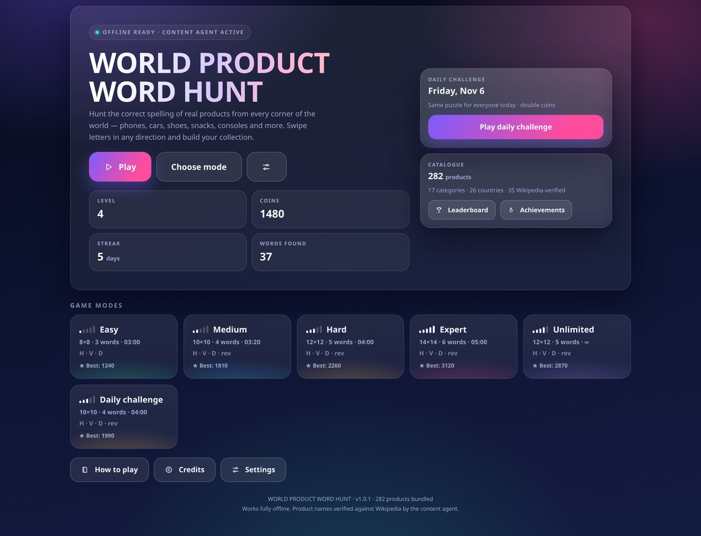
</p>

<p align="center">
  <a href="../../releases/latest"></a>
  
  
  
</p>

**▶ Play in your browser:** <https://technicalnihilist-lgtm.github.io/world-product-word-hunt/>
**⬇ Android APK:** <https://github.com/technicalnihilist-lgtm/world-product-word-hunt/releases/latest>

---

## What's in the box

| | |
|---|---|
| **282 products** | real, publicly documented product names |
| **17 categories** | smartphones → furniture → gaming → drinks |
| **26 countries** | Japan, India, Germany, USA, Brazil, South Korea, Sweden… |
| **6 modes** | Easy · Medium · Hard · Expert · Unlimited · Daily Challenge |
| **1 file** | the whole game is a single `index.html` (no build step needed to play) |
| **0 permissions** | the Android build asks for `VIBRATE` only — no internet, no ads, no analytics |

## Play it

**On a phone (recommended):** download `world-product-word-hunt.apk` from the
[latest release](../../releases/latest) and install it. Fully offline.

**In your browser, right now:** <https://technicalnihilist-lgtm.github.io/world-product-word-hunt/> — no install.

**On desktop / offline:** open `index.html`. That's it — double-click the
file. No server, no install, no network calls.

**As an installable web app:** serve the folder over HTTP (`npx http-server .`)
and use "Add to Home screen" — a service worker caches the shell so it keeps
working with the network off.

---

## Screenshots

| Game — Expert grid | Product card + word list |
|---|---|
| 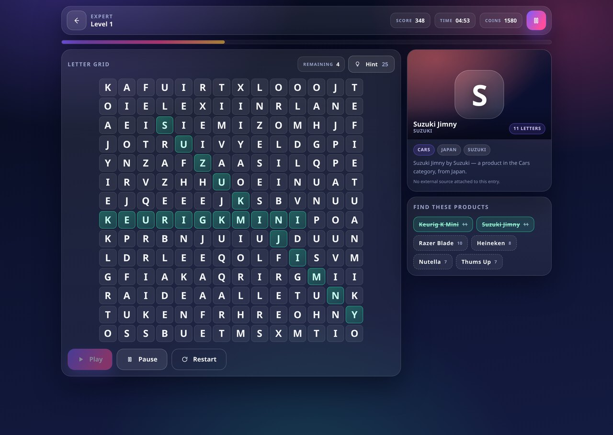 | 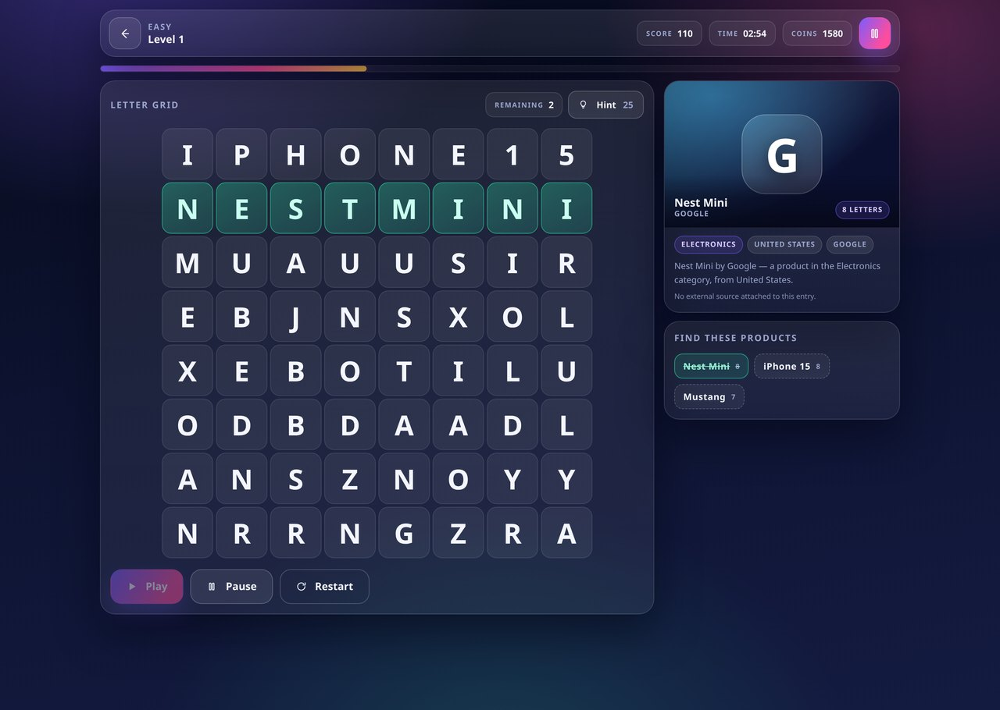 |

| Modes | Pause menu | Level complete |
|---|---|---|
| 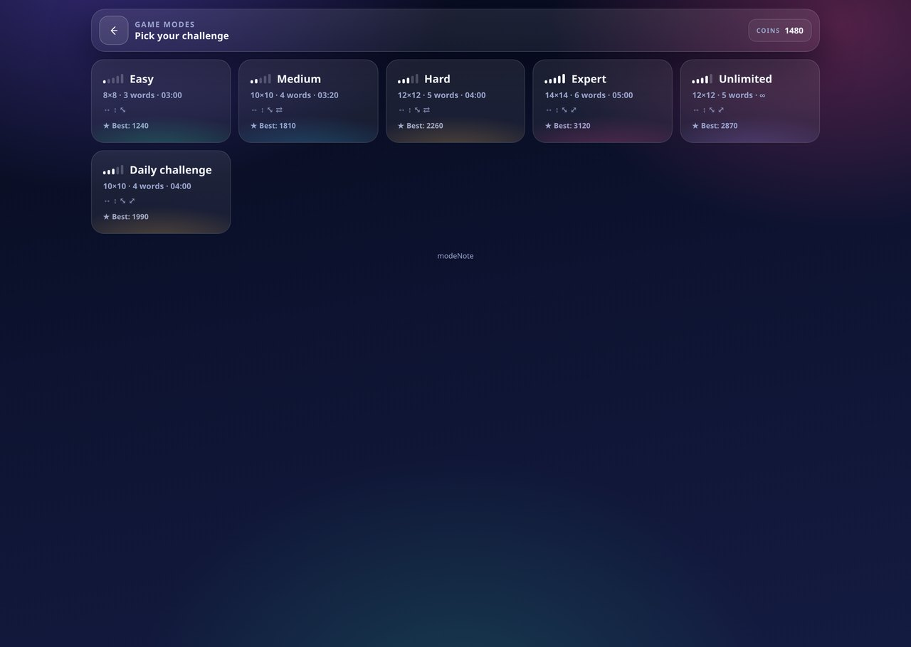 | 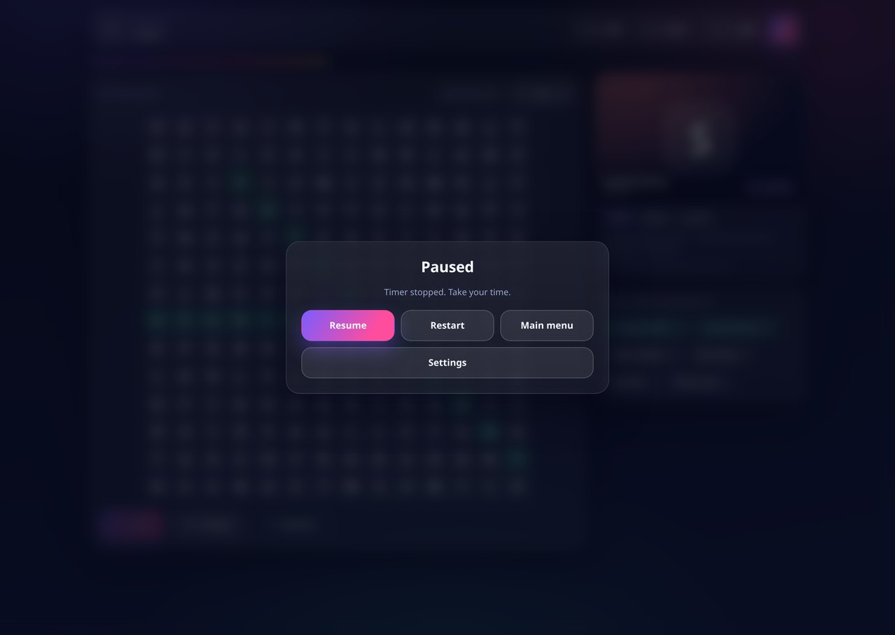 |  |

| Settings (dark) | Settings (light · हिन्दी) |
|---|---|
| 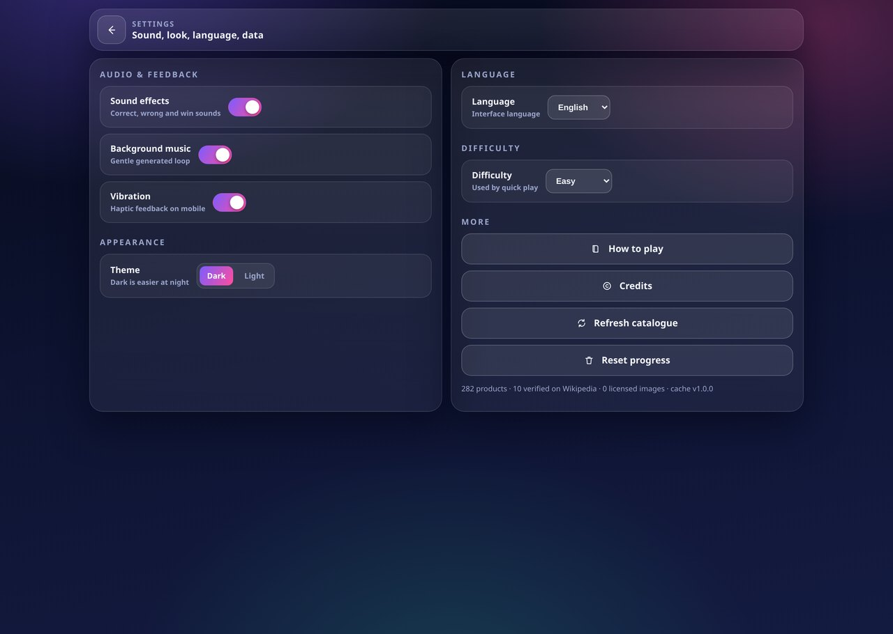 | 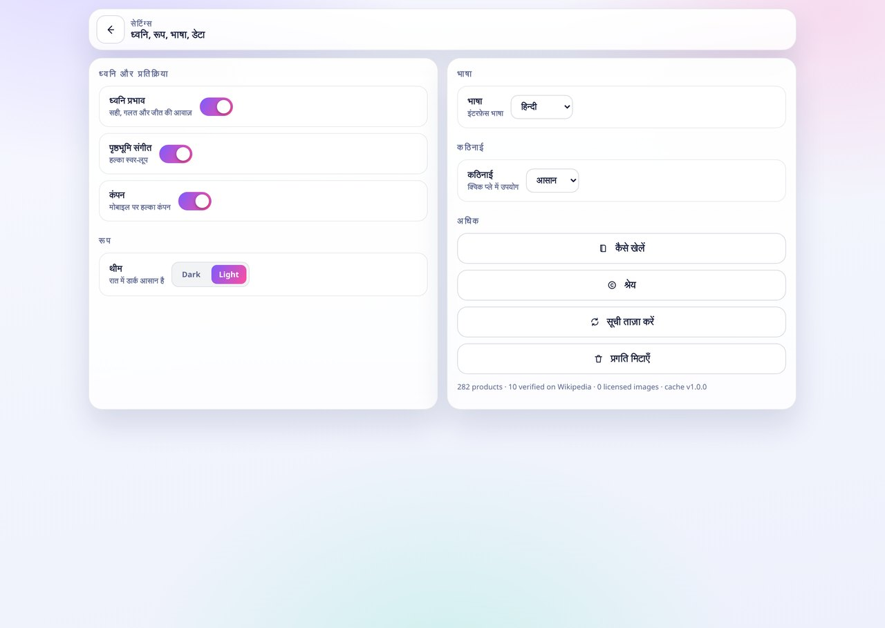 |

| Credits | Achievements | Leaderboard |
|---|---|---|
| 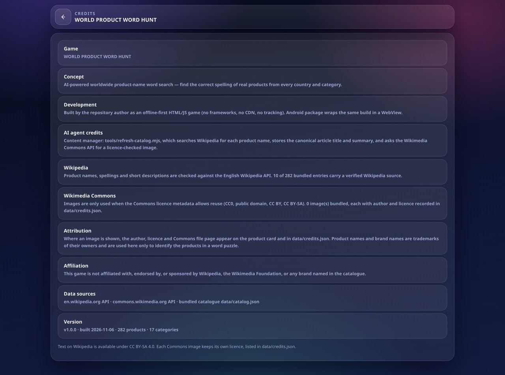 | 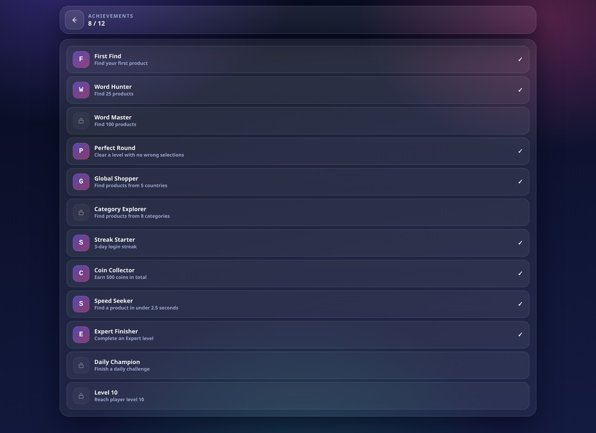 | 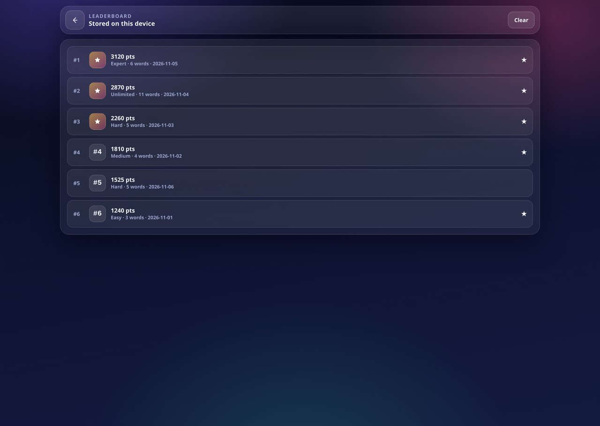 |

| How to play | Mobile — home | Mobile — game |
|---|---|---|
| 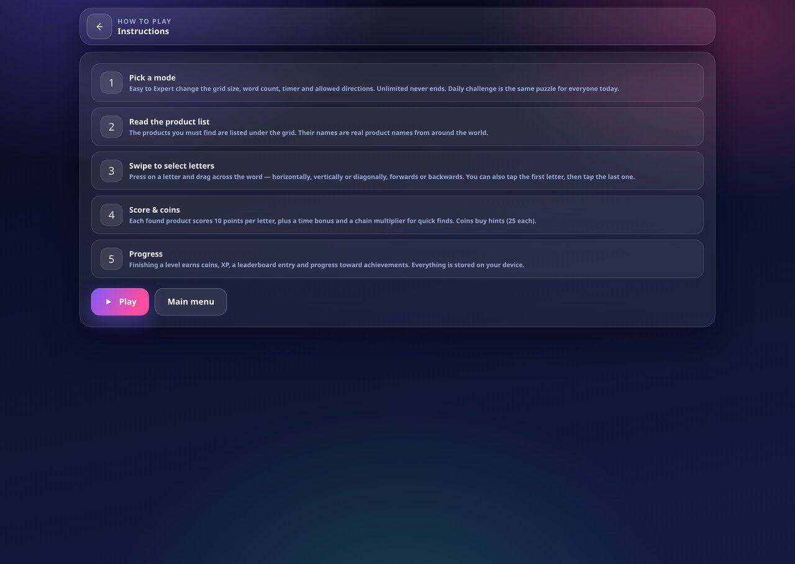 | 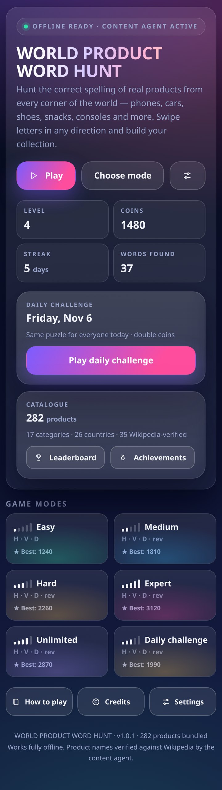 | 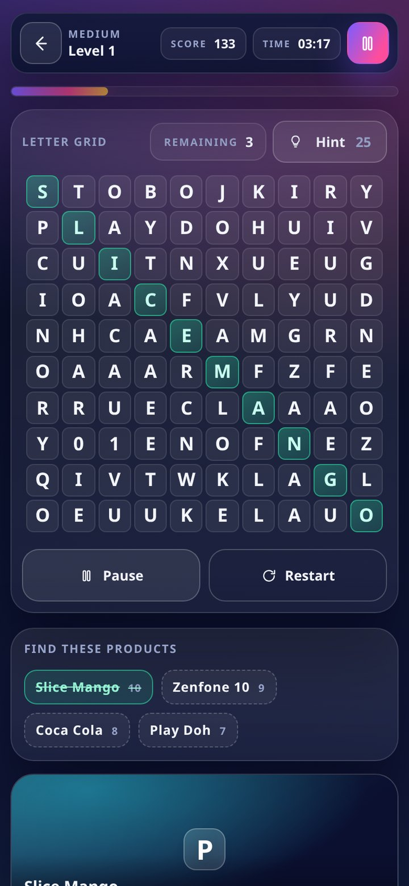 |

| Mobile — Expert (14×14) | Mobile — scrolled, sticky score bar | Mobile — modes |
|---|---|---|
| 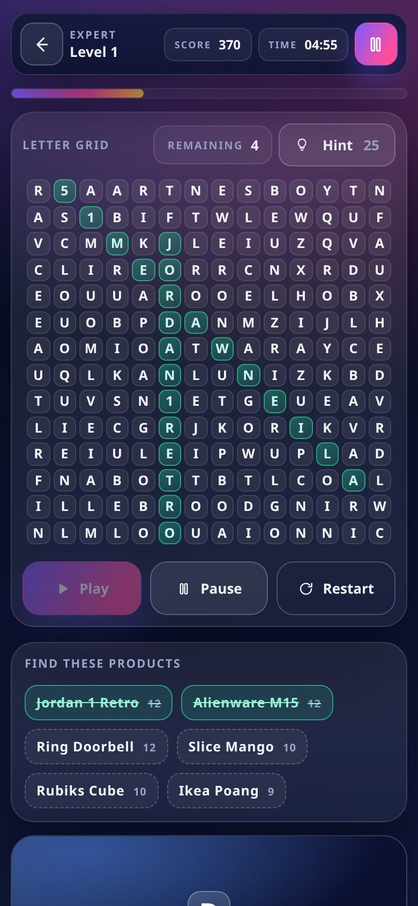 | 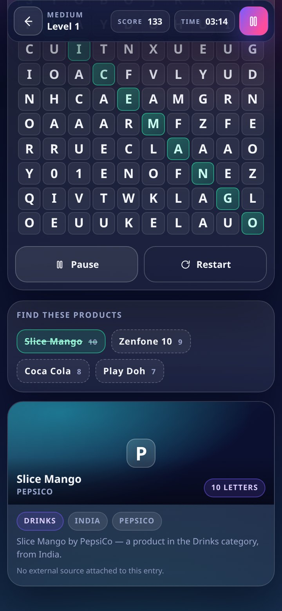 | 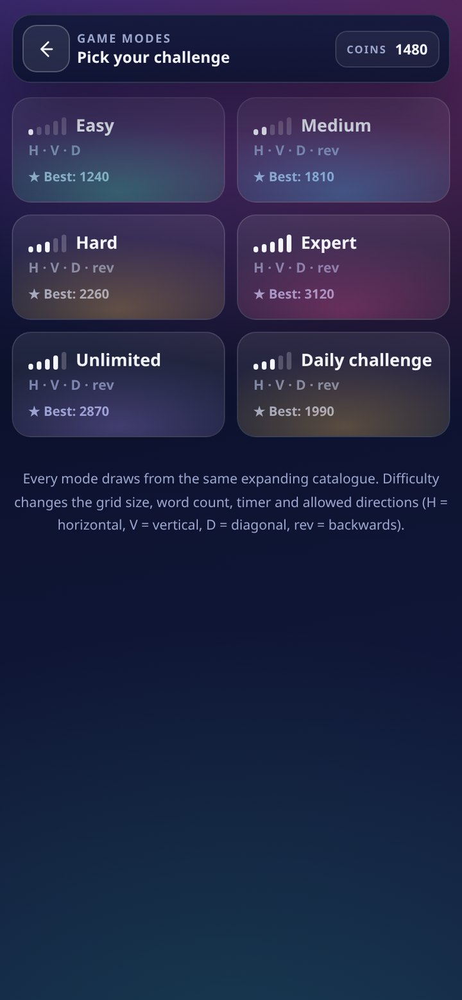 |

---

## How to play

1. **Pick a mode.** Easy → Expert change the grid size, the number of products,
   the timer and which directions are allowed. Unlimited never ends. The Daily
   Challenge is seeded from today's date, so it is the same puzzle for everyone.
2. **Read the product list** under the grid — those are the names you have to
   locate, spelled exactly as the real product is spelled.
3. **Swipe** across the letters (drag on desktop, drag or tap-tap on touch).
   Any straight line in any of the eight directions counts, in either direction.
4. **Score.** 10 points per letter, plus a time bonus and a chain multiplier for
   quick consecutive finds. Wrong selections break the chain.
5. **Coins** buy hints (25 each, reveals a starting letter and coordinates).
   Finishing a level earns coins, XP, stars, a leaderboard entry and progress
   toward 12 achievements.

### On a phone

The phone layout is the primary one, not a shrunken desktop: the letter grid
fills the width, **the list of products to find sits directly under it**, and the
product card comes after — so you never scroll past a card to see what you are
hunting. Score, timer and pause stay pinned in a sticky bar while you scroll,
the top bar drops to a single row, the six mode cards go two-up, and the action
row collapses to Pause + Restart while the clock runs. Layout is verified from
320 px to 430 px wide (no horizontal scroll at any of them) and honours
notch/safe-area insets.

### Modes

| Mode | Grid | Products | Timer | Directions |
|---|---|---|---|---|
| Easy | 8×8 | 3 | 3:00 | H, V, diagonal |
| Medium | 10×10 | 4 | 3:20 | + reverse |
| Hard | 12×12 | 5 | 4:00 | + full reverse |
| Expert | 14×14 | 6 | 5:00 | all 8 |
| Unlimited | 12×12 | 5 | ∞ | all 8 — endless batches |
| Daily | 10×10 | 4 | 4:00 | all 8 — seeded by date, double coins |

---

## The content agent

`tools/refresh-catalog.mjs` is the "AI agent" that keeps the catalogue growing
and correct. It runs at build time (and weekly on CI), never inside gameplay, so
the game itself never needs the network.

```bash
node tools/refresh-catalog.mjs                # verify + fetch licensed images
node tools/refresh-catalog.mjs --no-images    # spelling verification only
node tools/refresh-catalog.mjs --offline      # rebuild from the cache, no network
node tools/build.mjs                          # inline everything into index.html
```

What it does per product:

1. **Wikipedia search API** → canonical article title (spelling check).
2. **Wikipedia REST summary** → short description + canonical URL.
3. **Wikimedia Commons API** → licence metadata for that article image.
4. **Licence gate** → only `CC0`, public domain, `CC BY`, `CC BY-SA` pass.
5. **Download** a 560 px thumbnail into `assets/img/` so it works offline.
6. **De-duplicate** by name *and* by letter signature (so the same grid word
   never repeats) and write `data/catalog.json`, `data/credits.json`,
   `data/refresh-report.json`.

Every entry caches its own result in `data/agent-cache/<id>.json`, so a run can
be interrupted and resumed, and an unreachable source simply keeps the cached
value. **No image URL is ever invented** — an image is only shown if the Commons
API returned it and its licence allowed reuse; otherwise the game draws a
generated monogram card.

The in-game **Settings → Refresh catalogue** button fetches `catalog.json` and
merges any new products into the local cache; if that fails it says "offline"
and keeps playing.

### Honest status of this build

Wikimedia's API is rate-limited per IP. In the build committed here the agent
verified **35 of 282** product names and stored a licensed image for **1** of
them; the rest of the catalogue ships with hand-curated, publicly known product
data and no external claims attached. Run `npm run refresh` from a normal
network and the numbers go up — the catalogue is designed to hold millions of
entries, and everything is content-addressed by product id.

---

## Android

The APK is a thin WebView shell around the same `index.html`
(`android/src/com/worldproduct/wordhunt/MainActivity.java`). Assets are bundled
inside the package, so the app is fully offline and requests **no** internet
permission.

Build it yourself without Gradle (needs JDK 17+, Android build-tools, an
`android.jar`):

```bash
BUILD_TOOLS=/path/to/build-tools/android-14 \
ANDROID_JAR=/path/to/platforms/android-34/android.jar \
./tools/build-apk.sh
# → dist/world-product-word-hunt.apk  (signed with a debug key)
```

`.github/workflows/android-apk.yml` does the same on every tag and attaches the
APK to the release.

---

## Project layout

```
index.html               ← the built game (generated, committed so it plays from file://)
catalog.json             ← catalogue served to the in-game refresh button
src/
  index.template.html    ← markup, placeholders for CSS/JS/data
  game.css               ← design system (dark + light, mobile first)
  game.js                ← engine: puzzles, input, scoring, i18n, achievements
data/
  catalog.seed.json      ← curated seed list [name, brand, category, country]
  catalog.json           ← agent output (bundled into the game)
  credits.json           ← per-image licence + author
  refresh-report.json    ← last agent run
tools/
  refresh-catalog.mjs    ← the content agent
  build.mjs              ← inlines CSS + JS + catalogue → index.html
  build-apk.sh           ← Gradle-free APK build
android/                 ← manifest, resources, MainActivity
assets/                  ← icons, licensed product images
screenshots/             ← images used by this README
```

## Engineering notes

* **One self-contained file.** CSS, JS and the whole catalogue are inlined at
  build time, so `index.html` works from `file://` inside a WebView — where
  `fetch()` of local JSON is blocked.
* **Puzzle generator** places each word in a random allowed direction with
  letter-overlap scoring, fills the gaps with vowel-biased letters, and retries
  until every requested word is on the board. Words that are substrings of each
  other are never mixed into one grid.
* **Input** uses pointer events with `elementFromPoint`, so drag works with
  mouse, finger and stylus, plus tap-first-letter / tap-last-letter for small
  screens.
* **Sound** is synthesised with WebAudio (no audio files), music is a generated
  loop, and both have independent on/off switches.
* **State** (coins, XP, streaks, achievements, high scores, settings) lives in
  `localStorage`; nothing leaves the device.
* **i18n**: English, हिन्दी, Español, Français, Deutsch — the interface, not the
  product names (those stay in their real spelling, which is the point of the
  game).

## Licence

Code: MIT (`LICENSE`). Product names are trademarks of their owners; images keep
their Commons licences (`data/credits.json`); Wikipedia text is CC BY-SA 4.0.
Not affiliated with Wikipedia, the Wikimedia Foundation, or any brand named in
the catalogue. See [CREDITS.md](CREDITS.md).
