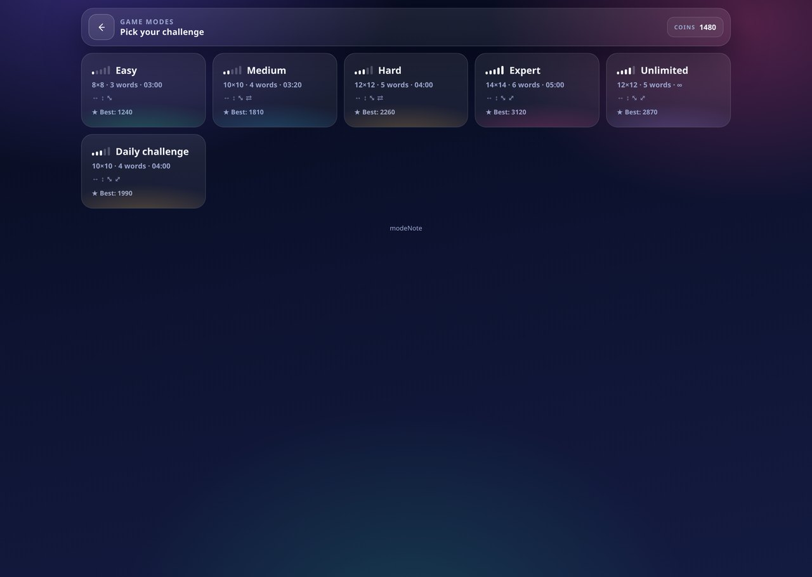
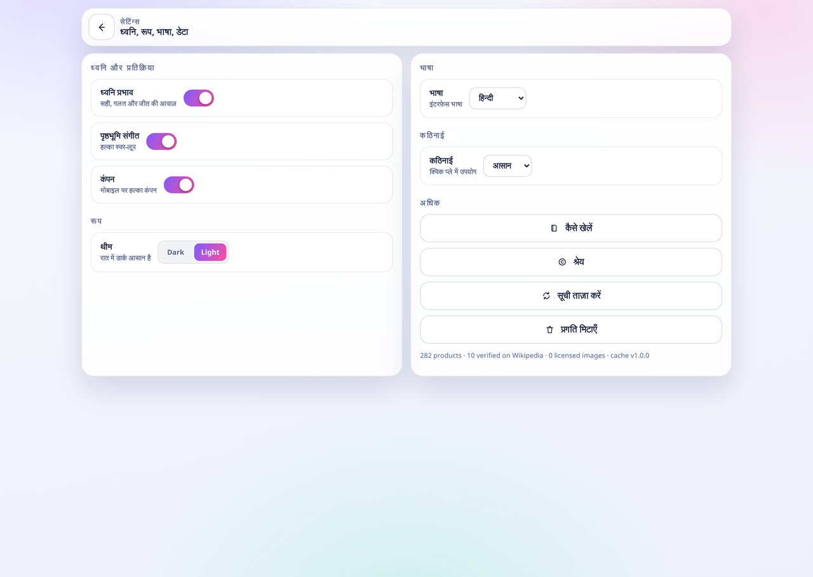
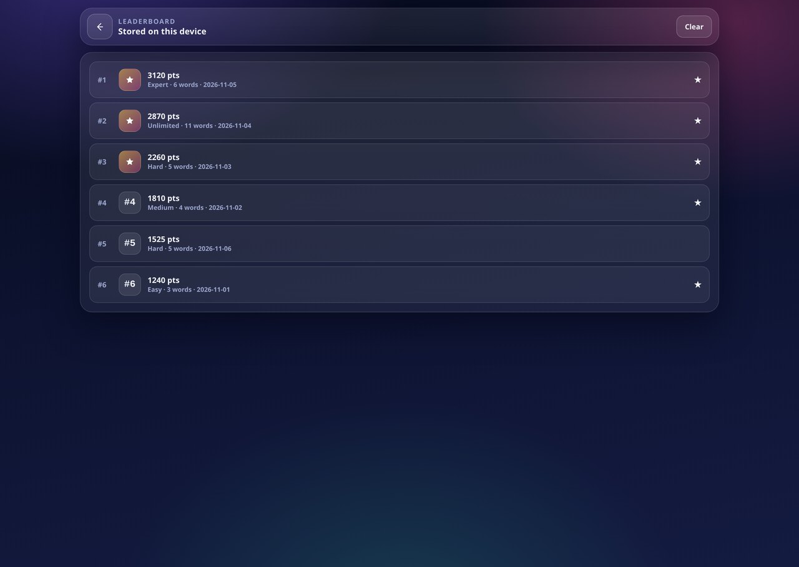
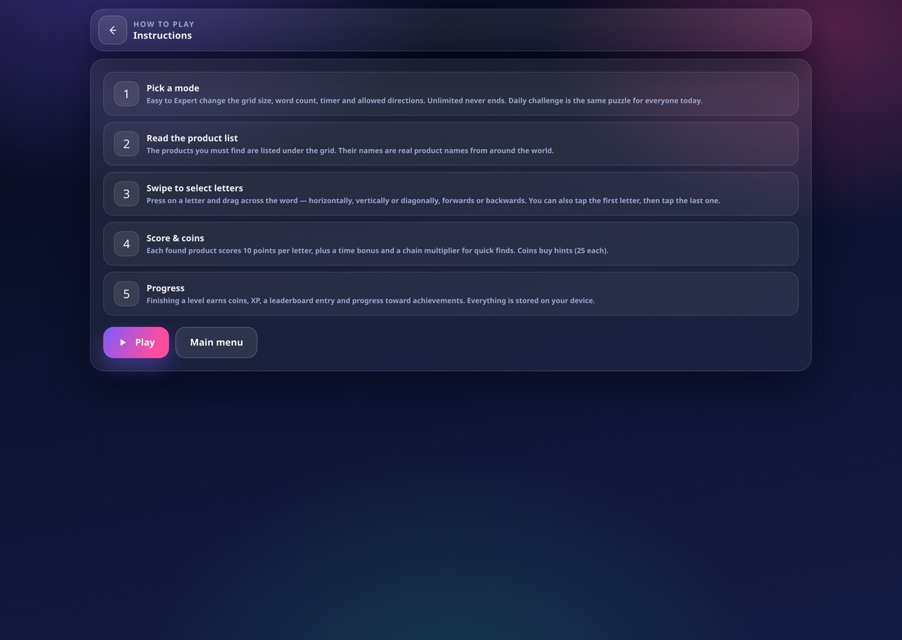
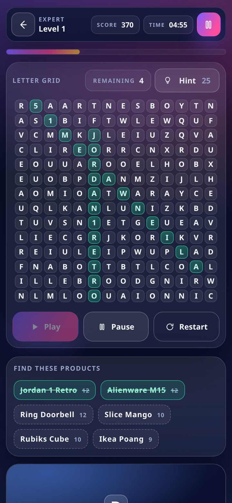

<div align="center">

<a href="https://github.com/technicalnihilist-lgtm/world-product-word-hunt/stargazers"></a>&nbsp;<a href="https://github.com/technicalnihilist-lgtm/world-product-word-hunt/network/members"></a>

<h3>WORLD PRODUCT WORD HUNT — offline-first worldwide product-name word-search game: 282 real products…</h3>

   

<a href="https://github.com/technicalnihilist-lgtm/world-product-word-hunt/releases/latest"></a> <a href="https://technicalnihilist-lgtm.github.io/world-product-word-hunt/"></a>

<b>Support the work</b>

  

<sub>Donations aren't live yet — Paytm, UPI, PayPal and Buy&nbsp;Me&nbsp;a&nbsp;Coffee all show <b>coming soon</b>. Until then, a ⭐ star is the best support.</sub>

<a href="https://github.com/technicalnihilist-lgtm/world-product-word-hunt/releases/latest"></a>  <a href="https://technicalnihilist-lgtm.github.io/world-product-word-hunt/"></a>

<h4>Get it from</h4>

<a href="https://github.com/technicalnihilist-lgtm/world-product-word-hunt/releases"></a> <a href="https://technicalnihilist-lgtm.github.io/world-product-word-hunt/"></a> <a href="https://github.com/technicalnihilist-lgtm/world-product-word-hunt/archive/refs/heads/main.zip"></a>

</div>

---

---

## What's in the box

| | |
|---|---|
| **282 products** | real, publicly documented product names |
| **17 categories** | smartphones → furniture → gaming → drinks |
| **26 countries** | Japan, India, Germany, USA, Brazil, South Korea, Sweden… |
| **6 modes** | Easy · Medium · Hard · Expert · Unlimited · Daily Challenge |
| **1 file** | the whole game is a single `index.html` (no build step needed to play) |
| **0 permissions** | the Android build asks for `VIBRATE` only — no internet, no ads, no analytics |

## Play it

**On a phone (recommended):** download `world-product-word-hunt.apk` from the
[latest release](../../releases/latest) and install it. Fully offline.

**In your browser, right now:** <https://technicalnihilist-lgtm.github.io/world-product-word-hunt/> — no install.

**On desktop / offline:** open `index.html`. That's it — double-click the
file. No server, no install, no network calls.

**As an installable web app:** serve the folder over HTTP (`npx http-server .`)
and use "Add to Home screen" — a service worker caches the shell so it keeps
working with the network off.

---

## Screenshots

| Game — Expert grid | Product card + word list |
|---|---|
|  |  |

| Modes | Pause menu | Level complete |
|---|---|---|
|  |  |  |

| Settings (dark) | Settings (light · हिन्दी) |
|---|---|
|  |  |

| Credits | Achievements | Leaderboard |
|---|---|---|
|  |  |  |

| How to play | Mobile — home | Mobile — game |
|---|---|---|
|  |  |  |

| Mobile — Expert (14×14) | Mobile — scrolled, sticky score bar | Mobile — modes |
|---|---|---|
|  |  |  |

---

## How to play

1. **Pick a mode.** Easy → Expert change the grid size, the number of products,
   the timer and which directions are allowed. Unlimited never ends. The Daily
   Challenge is seeded from today's date, so it is the same puzzle for everyone.
2. **Read the product list** under the grid — those are the names you have to
   locate, spelled exactly as the real product is spelled.
3. **Swipe** across the letters (drag on desktop, drag or tap-tap on touch).
   Any straight line in any of the eight directions counts, in either direction.
4. **Score.** 10 points per letter, plus a time bonus and a chain multiplier for
   quick consecutive finds. Wrong selections break the chain.
5. **Coins** buy hints (25 each, reveals a starting letter and coordinates).
   Finishing a level earns coins, XP, stars, a leaderboard entry and progress
   toward 12 achievements.

### On a phone

The phone layout is the primary one, not a shrunken desktop: the letter grid
fills the width, **the list of products to find sits directly under it**, and the
product card comes after — so you never scroll past a card to see what you are
hunting. Score, timer and pause stay pinned in a sticky bar while you scroll,
the top bar drops to a single row, the six mode cards go two-up, and the action
row collapses to Pause + Restart while the clock runs. Layout is verified from
320 px to 430 px wide (no horizontal scroll at any of them) and honours
notch/safe-area insets.

### Modes

| Mode | Grid | Products | Timer | Directions |
|---|---|---|---|---|
| Easy | 8×8 | 3 | 3:00 | H, V, diagonal |
| Medium | 10×10 | 4 | 3:20 | + reverse |
| Hard | 12×12 | 5 | 4:00 | + full reverse |
| Expert | 14×14 | 6 | 5:00 | all 8 |
| Unlimited | 12×12 | 5 | ∞ | all 8 — endless batches |
| Daily | 10×10 | 4 | 4:00 | all 8 — seeded by date, double coins |

---

## The content agent

`tools/refresh-catalog.mjs` is the "AI agent" that keeps the catalogue growing
and correct. It runs at build time (and weekly on CI), never inside gameplay, so
the game itself never needs the network.

```bash
node tools/refresh-catalog.mjs                # verify + fetch licensed images
node tools/refresh-catalog.mjs --no-images    # spelling verification only
node tools/refresh-catalog.mjs --offline      # rebuild from the cache, no network
node tools/build.mjs                          # inline everything into index.html
```

What it does per product:

1. **Wikipedia search API** → canonical article title (spelling check).
2. **Wikipedia REST summary** → short description + canonical URL.
3. **Wikimedia Commons API** → licence metadata for that article image.
4. **Licence gate** → only `CC0`, public domain, `CC BY`, `CC BY-SA` pass.
5. **Download** a 560 px thumbnail into `assets/img/` so it works offline.
6. **De-duplicate** by name *and* by letter signature (so the same grid word
   never repeats) and write `data/catalog.json`, `data/credits.json`,
   `data/refresh-report.json`.

Every entry caches its own result in `data/agent-cache/<id>.json`, so a run can
be interrupted and resumed, and an unreachable source simply keeps the cached
value. **No image URL is ever invented** — an image is only shown if the Commons
API returned it and its licence allowed reuse; otherwise the game draws a
generated monogram card.

The in-game **Settings → Refresh catalogue** button fetches `catalog.json` and
merges any new products into the local cache; if that fails it says "offline"
and keeps playing.

### Honest status of this build

Wikimedia's API is rate-limited per IP. In the build committed here the agent
verified **35 of 282** product names and stored a licensed image for **1** of
them; the rest of the catalogue ships with hand-curated, publicly known product
data and no external claims attached. Run `npm run refresh` from a normal
network and the numbers go up — the catalogue is designed to hold millions of
entries, and everything is content-addressed by product id.

---

## Android

The APK is a thin WebView shell around the same `index.html`
(`android/src/com/worldproduct/wordhunt/MainActivity.java`). Assets are bundled
inside the package, so the app is fully offline and requests **no** internet
permission.

Build it yourself without Gradle (needs JDK 17+, Android build-tools, an
`android.jar`):

```bash
BUILD_TOOLS=/path/to/build-tools/android-14 \
ANDROID_JAR=/path/to/platforms/android-34/android.jar \
./tools/build-apk.sh
## Project layout

```
index.html               ← the built game (generated, committed so it plays from file://)
catalog.json             ← catalogue served to the in-game refresh button
src/
  index.template.html    ← markup, placeholders for CSS/JS/data
  game.css               ← design system (dark + light, mobile first)
  game.js                ← engine: puzzles, input, scoring, i18n, achievements
data/
  catalog.seed.json      ← curated seed list [name, brand, category, country]
  catalog.json           ← agent output (bundled into the game)
  credits.json           ← per-image licence + author
  refresh-report.json    ← last agent run
tools/
  refresh-catalog.mjs    ← the content agent
  build.mjs              ← inlines CSS + JS + catalogue → index.html
  build-apk.sh           ← Gradle-free APK build
android/                 ← manifest, resources, MainActivity
assets/                  ← icons, licensed product images
screenshots/             ← images used by this README
```

## Engineering notes

* **One self-contained file.** CSS, JS and the whole catalogue are inlined at
  build time, so `index.html` works from `file://` inside a WebView — where
  `fetch()` of local JSON is blocked.
* **Puzzle generator** places each word in a random allowed direction with
  letter-overlap scoring, fills the gaps with vowel-biased letters, and retries
  until every requested word is on the board. Words that are substrings of each
  other are never mixed into one grid.
* **Input** uses pointer events with `elementFromPoint`, so drag works with
  mouse, finger and stylus, plus tap-first-letter / tap-last-letter for small
  screens.
* **Sound** is synthesised with WebAudio (no audio files), music is a generated
  loop, and both have independent on/off switches.
* **State** (coins, XP, streaks, achievements, high scores, settings) lives in
  `localStorage`; nothing leaves the device.
* **i18n**: English, हिन्दी, Español, Français, Deutsch — the interface, not the
  product names (those stay in their real spelling, which is the point of the
  game).

## Licence

Code: MIT (`LICENSE`). Product names are trademarks of their owners; images keep
their Commons licences (`data/credits.json`); Wikipedia text is CC BY-SA 4.0.
Not affiliated with Wikipedia, the Wikimedia Foundation, or any brand named in
the catalogue. See [CREDITS.md](CREDITS.md).

---

## 🌍 Languages

<sub>Donations are <b>coming soon</b> in every language below — nothing to pay today, nothing to click.</sub>

<div align="center">

<sub><b>हिन्दी · বাংলা · मराठी · తెలుగు · தமிழ் · ગુજરાતી · ಕನ್ನಡ · മലയാളം · ਪੰਜਾਬੀ · ଓଡ଼ିଆ · অসমীয়া · اردو</b></sub>

</div>

<details>
<summary><b>🌍 Open the same message in 53 languages</b></summary>

**🇮🇳 Indian languages**

- **हिन्दी** (Hindi) — ☕ जल्द ही आ रहा है। · ⭐ अगर आपको यह ऐप और हमारा काम पसंद है, तो कृपया रिपॉजिटरी को स्टार दें और हमें फॉलो करें।
- **বাংলা** (Bengali) — ☕ খুব শিগগিরই আসছে। · ⭐ যদি আপনার এই অ্যাপ এবং আমাদের কাজ ভালো লাগে, তবে অনুগ্রহ করে রিপোজিটরিটিকে একটি স্টার দিন এবং আমাদের ফলো করুন।
- **मराठी** (Marathi) — ☕ लवकरच येत आहे. · ⭐ जर तुम्हाला हे ॲप आणि आमचं काम आवडलं असेल, तर कृपया रिपॉझिटरीला स्टार द्या आणि आम्हाला फॉलो करा.
- **తెలుగు** (Telugu) — ☕ త్వరలో రాబోతోంది. · ⭐ మీకు ఈ యాప్, మా పని నచ్చితే, దయచేసి రిపోజిటరీకి ఒక స్టార్ ఇచ్చి మమ్మల్ని ఫాలో అవ్వండి.
- **தமிழ்** (Tamil) — ☕ விரைவில் வருகிறது. · ⭐ உங்களுக்கு இந்த ஆப்பும் எங்க வேலையும் பிடிச்சிருந்தா, தயவுசெஞ்சு இந்த ரெபாசிட்டரிக்கு ஒரு ஸ்டார்…
- **ગુજરાતી** (Gujarati) — ☕ ટૂંક સમયમાં આવી રહ્યું છે. · ⭐ જો તમને આ એપ અને અમારું કામ ગમતું હોય, તો પ્લીઝ રિપોઝિટરીને સ્ટાર આપો અને અમને ફોલો કરો.
- **ಕನ್ನಡ** (Kannada) — ☕ ಶೀಘ್ರದಲ್ಲೇ ಬರುತ್ತಿದೆ. · ⭐ ನಿಮಗೆ ಈ ಆ್ಯಪ್ ಮತ್ತು ನಮ್ಮ ಕೆಲಸ ಇಷ್ಟವಾದರೆ, ದಯವಿಟ್ಟು ರೆಪೊಸಿಟರಿಗೆ ಸ್ಟಾರ್ ಕೊಡಿ ಮತ್ತು ನಮ್ಮನ್ನು ಫಾಲೋ ಮಾಡಿ.
- **മലയാളം** (Malayalam) — ☕ ഉടൻ വരുന്നു. · ⭐ നിങ്ങൾക്ക് ഈ ആപ്പും ഞങ്ങളുടെ പ്രവർത്തനവും ഇഷ്ടപ്പെട്ടെങ്കിൽ, ദയവായി റെപ്പോസിറ്ററിക്ക് ഒരു സ്റ്റാർ…
- **ਪੰਜਾਬੀ** (Punjabi) — ☕ ਜਲਦੀ ਆ ਰਿਹਾ ਹੈ। · ⭐ ਜੇ ਤੁਹਾਨੂੰ ਇਹ ਐਪ ਅਤੇ ਸਾਡਾ ਕੰਮ ਪਸੰਦ ਹੈ, ਤਾਂ ਕਿਰਪਾ ਕਰਕੇ ਰਿਪੋਜ਼ਟਰੀ ਨੂੰ ਸਟਾਰ ਦਿਓ ਅਤੇ ਸਾਨੂੰ ਫਾਲੋ ਕਰੋ।
- **ଓଡ଼ିଆ** (Odia) — ☕ ଖୁବ୍ ଶୀଘ୍ର ଆସୁଛି। · ⭐ ଯଦି ଆପଣଙ୍କୁ ଏହି ଆପ୍ ଏବଂ ଆମର କାମ ଭଲ ଲାଗୁଛି, ତେବେ ଦୟାକରି ରିପୋଜିଟୋରୀକୁ ଗୋଟିଏ ଷ୍ଟାର୍ ଦିଅନ୍ତୁ ଏବଂ ଆମକୁ ଫଲୋ କରନ୍ତୁ।
- **অসমীয়া** (Assamese) — ☕ অতি সোনকালেই আহি আছে। · ⭐ যদি আপুনি এই এপটো আৰু আমাৰ কাম ভাল পায়, তেন্তে অনুগ্ৰহ কৰি ৰিপজিটৰীটোক এটা ষ্টাৰ দিয়ক আৰু আমাক ফ'ল' কৰক।
- **اردو** (Urdu) — ☕ جلد آرہا ہے۔ · ⭐ اگر آپ کو یہ ایپ اور ہمارا کام پسند آئے تو براہ کرم ریپازٹری کو سٹار دیں اور ہمیں فالو کریں۔
- **संस्कृतम्** (Sanskrit) — ☕ शीघ्रमेव आगच्छति।
- **मैथिली** (Maithili) — ☕ जल्दिये आबि रहल अछि।
- **कोंकणी** (Konkani) — ☕ रोखडेंच येता.
- **کٲشُر** (Kashmiri) — ☕ جَلدی یِوان چھُ۔
- **سنڌي** (Sindhi) — ☕ जल्द अची रह्यो आहे।
- **डोगरी** (Dogri) — ☕ जल्दी आ करदा ऐ।
- **ꯃꯤꯇꯩ ꯂꯣꯟ** (Manipuri) — ☕ ꯑꯊꯨꯕꯥ ꯃꯇꯝꯗꯥ ꯂꯥꯛꯀꯅꯤ꯫
- **बर’** (Bodo) — ☕ थाबैनो फैगोन।
- **ᱥᱟᱱᱛᱟᱲᱤ** (Santali) — ☕ ᱞᱚᱜᱚᱱ ᱦᱤᱡᱩᱜ ᱠᱟᱱᱟ᱾
- **नेपाली** (Nepali) — ☕ छिट्टै आउँदैछ। · ⭐ यदि तपाईंलाई यो एप र हाम्रो काम मन पर्‍यो भने, कृपया रिपोजिटरीलाई स्टार दिनुहोस् र हामीलाई फलो गर्नुहोस्।

**🌍 World languages**

- **العربية** (Arabic) — ☕ قريبًا. · ⭐ إذا أعجبك هذا التطبيق وعملنا، فيرجى منح المستودع نجمة ومتابعتنا.
- **简体中文** (Chinese (Simplified)) — ☕ 即将推出。
- **繁體中文** (Chinese (Traditional)) — ☕ 即將推出。
- **Čeština** (Czech) — ☕ Již brzy.
- **Dansk** (Danish) — ☕ Kommer snart.
- **Nederlands** (Dutch) — ☕ Binnenkort beschikbaar. · ⭐ Vind je deze app en ons werk leuk?
- **Filipino** (Filipino) — ☕ Malapit na.
- **Suomi** (Finnish) — ☕ Tulossa pian.
- **Français** (French) — ☕ Bientôt disponible. · ⭐ Si cette application et notre travail vous plaisent, mettez une étoile au dépôt et suivez-nous.
- **Deutsch** (German) — ☕ Bald verfügbar. · ⭐ Wenn dir diese App und unsere Arbeit gefallen, gib dem Repository einen Stern und folge uns.
- **Ελληνικά** (Greek) — ☕ Έρχεται σύντομα.
- **עברית** (Hebrew) — ☕ בקרוב.
- **Magyar** (Hungarian) — ☕ Hamarosan.
- **Bahasa Indonesia** (Indonesian) — ☕ Segera hadir. · ⭐ Jika kamu suka aplikasi ini dan karya kami, beri bintang pada repositori ini dan ikuti kami.
- **Italiano** (Italian) — ☕ In arrivo.
- **日本語** (Japanese) — ☕ 近日公開。 · ⭐ このアプリと私たちの仕事が気に入ったら、リポジトリにスターを付けてフォローしてください。
- **한국어** (Korean) — ☕ 곧 공개됩니다. · ⭐ 이 앱과 저희 작업이 마음에 드신다면 저장소에 스타를 눌러 주시고 팔로우해 주세요.
- **Bahasa Melayu** (Malay) — ☕ Akan datang.
- **Norsk** (Norwegian) — ☕ Kommer snart.
- **فارسی** (Persian) — ☕ به‌زودی.
- **Polski** (Polish) — ☕ Wkrótce. · ⭐ Jeśli podoba Ci się ta aplikacja i nasza praca, daj repozytorium gwiazdkę i obserwuj nas.
- **Português** (Portuguese) — ☕ Em breve.
- **Română** (Romanian) — ☕ În curând.
- **Русский** (Russian) — ☕ Скоро. · ⭐ Если вам нравится это приложение и наша работа, поставьте звёздочку репозиторию и подпишитесь на нас.
- **Español** (Spanish) — ☕ Muy pronto. · ⭐ Si te gusta esta app y nuestro trabajo, dale una estrella al repositorio y síguenos.
- **Kiswahili** (Swahili) — ☕ Inakuja hivi karibuni.
- **Svenska** (Swedish) — ☕ Kommer snart.
- **ไทย** (Thai) — ☕ เร็ว ๆ นี้
- **Türkçe** (Turkish) — ☕ Çok yakında.
- **Українська** (Ukrainian) — ☕ Незабаром.
- **Tiếng Việt** (Vietnamese) — ☕ Sắp ra mắt. · ⭐ Nếu bạn thích ứng dụng này và công việc của chúng tôi, hãy tặng kho lưu trữ một ngôi sao và theo…

</details>

